<picture>
  <source media="(prefers-color-scheme: dark)" srcset="assets/city-dark.svg" />
  <source media="(prefers-color-scheme: light)" srcset="assets/city-light.svg" />
  
</picture>

<picture>
  <source media="(prefers-color-scheme: dark)" srcset="assets/terminal-dark.svg" />
  <source media="(prefers-color-scheme: light)" srcset="assets/terminal-light.svg" />
  
</picture>

<picture>
  <source media="(prefers-color-scheme: dark)" srcset="assets/top-dark.svg" />
  <source media="(prefers-color-scheme: light)" srcset="assets/top-light.svg" />
  
</picture>

